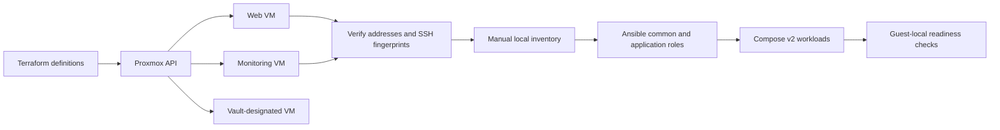

# Proxmox Infrastructure Automation Lab

Infrastructure-as-code lab combining Terraform VM definitions, Ansible configuration roles, Docker Compose workloads, and automated source validation.

Terraform | Ansible | Proxmox VE | Docker Compose v2 | GitHub Actions | Python | Bash

[Project status](PROJECT_STATUS.md) | [Architecture](docs/architecture.md) | [Static checks](https://github.com/Bailey7220/infrastructure-automation-platform/actions/workflows/format-check.yml) | [Preflight tests](https://github.com/Bailey7220/infrastructure-automation-platform/actions/workflows/preflight-tests.yml) | [License](LICENSE)

## Project overview

This personal learning project explores how to separate VM provisioning, host configuration, application setup, and validation in a Proxmox homelab. Terraform defines three VMs; Ansible contains common, webserver, and monitoring roles; CI checks source configuration without accessing the lab.

The engineering work includes dependency locking across Windows and Linux, isolated preflight regression tests, shell line-ending controls, SSH verification requirements, and explicit boundaries between source validation and deployment evidence.

## Current validation status

| Area | Status |
|---|---|
| Terraform formatting, provider initialization, and configuration validation | Successful local Ubuntu terminal results supplied by the owner |
| Ansible Core 2.16.14 and project configuration | Successful local syntax check with the intended ansible.cfg loaded |
| GitHub static checks and preflight regression tests | Owner reported passing; workflow links above show available runs, not a fixed passing result for every commit |
| GitLab pipeline | Defined in source; passing results not recorded |
| Proxmox deployment, guest role execution, monitoring health, and restore | Unverified |

The last documented hardware state is powered off. This is not an operating production platform. Deployment and cleanup scripts are intentionally disabled. Exact Actions run URLs and complete logs have not been independently recorded; inspect the run for the commit you review.

## Architecture and handoff



This is an intended component flow, not a verified deployed topology. Inventory handoff is manual. The Vault-designated VM does not establish a working Vault service or secrets integration.

## Implemented components

- Terraform: three VM definitions with CPU, memory, disk, network, guest-agent, and SSH public-key settings; locked Proxmox provider and Linux/Windows checksums.
- Ansible: common host prerequisites plus web and monitoring roles using Compose v2 modules. The common role checks for Compose 2.18 or newer.
- Monitoring safeguards: a private Grafana password input passed under no_log, guest-loopback published ports, and explicit HTTP readiness retries.
- Static CI: Terraform formatting/init/validation, collection installation, Ansible syntax, and shell syntax/carriage-return checks.
- Local preflight: prerequisite and authentication-variable presence checks without invoking Terraform, Ansible, or SSH.
- Regression tests: six unittest cases with temporary dummy files, fake authentication values, and command stubs. Tests cover success/failure paths and check that dummy credential values are not printed or infrastructure commands invoked.

These components are implemented in source; static checks do not prove successful execution against guests.

## Engineering problems addressed

| Problem | Resolution | Demonstrated boundary |
|---|---|---|
| Provider installation failed with openpgp: key expired | Updated Terraform CLI from 1.6.0 to 1.6.1 without upgrading the provider | Installation issue resolved in supplied results |
| Windows CRLF broke Bash options | Added shell LF checkout rules and CI carriage-return checks | Prevents this class of tracked shell line-ending regression |
| Ansible ignored configuration on a world-writable Windows mount | Used a Linux-side WSL checkout and isolated Ansible environment | Intended configuration loaded in supplied syntax-check output |
| Linux provider cache failed lockfile validation | Recorded verified linux_amd64 checksums alongside existing Windows hashes | Read-only initialization and validation passed locally |

## Static validation quick start

Use a Linux environment with Terraform 1.6.1, Ansible Core 2.16.14, Python, and Bash. The collection requirement selects community.docker 3.13.3. These are compatibility pins, not currently supported-toolchain claims; upgrading them is separate work.

From the repository root, run each command individually and stop on failure:

```sh
terraform -chdir=terraform fmt -check -no-color
terraform -chdir=terraform init -backend=false -input=false -lockfile=readonly
terraform -chdir=terraform validate -no-color
python3 -m unittest discover -s tests -p 'test_preflight.py' -v
cd ansible
ansible-galaxy collection install -r requirements.yml
ansible-playbook --syntax-check -i inventory.ini playbook.yml
```

Dependency installation requires network access. These checks do not require lab credentials or an active inventory. Tests use dummy fixtures, not your local secrets. On WSL, use a Linux-side checkout with trustworthy permissions and confirm Ansible loads ansible/ansible.cfg; do not bypass its configuration safety warning. Windows Git may still be used for repository authentication and editing.

See the [pipeline guide](docs/PIPELINE.md) for platform-locking and evidence requirements, and the [preflight guide](docs/PREFLIGHT.md) for the separate local prerequisite check.

## VM definitions and deployment prerequisites

| VM | vCPU | RAM | Disk | Storage |
|---|---:|---:|---:|---|
| web-server-001 | 2 | 2 GB | 20 GB | sas-disk1 |
| monitoring-001 | 2 | 4 GB | 30 GB | sas-disk1 |
| vault-001 | 2 | 2 GB | 10 GB | sas-disk1 |

Definitions depend on template VM 300, bridge vmbr0, DHCP, and local:snippets/cloud-init.yaml. Verify template disk sizes and guest-agent setup; disk shrinking is not implemented. Outputs are best-effort guest addresses, not verified inventory targets.

For a separately reviewed deployment, copy terraform/terraform.tfvars.example to an ignored local terraform/terraform.tfvars and configure the actual node and public-key path. Provider authentication uses PROXMOX_VE_ENDPOINT with PROXMOX_VE_API_TOKEN or PROXMOX_VE_USERNAME/PROXMOX_VE_PASSWORD. The endpoint is the base HTTPS URL on port 8006, without /api2/json. Keep TLS verification enabled; some operations additionally need node SSH access.

[Authentication reference for pinned provider](https://github.com/bpg/terraform-provider-proxmox/blob/v0.57.1/docs/index.md)

## Security and known limitations

- Rotate/revoke exposed credentials and assess historical copies. Current-branch cleanup does not erase history or rotate running-service credentials.
- Preserve private Terraform state for existing VMs; do not apply blindly with missing state. Never commit state, tokens, passwords, or private keys.
- Review external cloud-init/template credentials, storage, networking, verified SSH fingerprints, sudo, and inventory before any execution.
- Guest availability of docker.io and docker-compose-v2, exact container image versions, repeat execution, monitoring scrapes, network isolation, and restores remain unverified.
- Supply grafana_admin_password through an encrypted, untracked vars file. The role requires at least 16 characters. Initialization inputs do not prove an existing Grafana account was rotated; Docker administrators may inspect container environments.
- Monitoring ports bind to guest loopback; secure external access requires deliberate configuration. A readiness response is not proof of full monitoring coverage.
- Top-level monitoring files, the Vault policy, and the inactive ansible-common task file are empty placeholders. They are not additional working features.
- Deployment/destruction scripts remain blocked pending separately reviewed and tested replacements.

See [security remediation](docs/SECURITY_REMEDIATION.md), [project status](PROJECT_STATUS.md), and the [measurement plan](docs/metrics.md). No measured uptime, time savings, compliance score, working Vault integration, or successful restore is claimed.

## Repository guide

| Path | Purpose |
|---|---|
| terraform/ | VM definitions, inputs, outputs, and provider lockfile |
| ansible/ | Active roles, deliberately inactive inventory, and collection requirements |
| scripts/ | Local preflight and disabled deployment/cleanup entry points |
| tests/ | Isolated preflight regression tests |
| .github/workflows/ | Static checks and fixture-test workflows |
| docs/ | Architecture, pipeline, security, preflight, and measurement guidance |
| monitoring/ and vault/ | Documented standalone placeholders |

Related project: [Systems and Security Homelab](https://github.com/Bailey7220/Systems_and_Security_Homelab).

## License

Original project material is available under the [MIT License](LICENSE), copyright 2026 Bailey Collins. Dependencies, provider binaries, container images, and any third-party material retain their respective licenses. This repository's license does not relicense those components.
