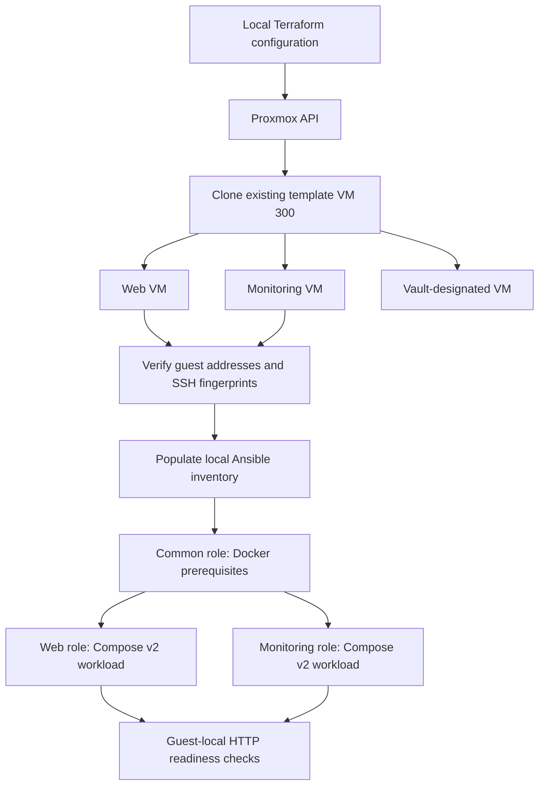

# Intended Architecture

This diagram describes relationships between the project's source components. It is not a verified network topology or evidence of a successful deployment. The lab is powered off.

The Vault-designated VM is defined in Terraform but is not shown as configured by an active Vault Ansible role. A VM name does not establish a working secrets service.

## Provisioning boundaries

- Terraform defines three VMs with CPU, memory, disks, bridge attachment, and initialization settings.
- Definitions depend on an existing template, storage pool, bridge, and external cloud-init snippet.
- Provider API credentials are supplied outside Git. Some operations can additionally require node SSH access.
- Terraform outputs provide convenience addresses and VM IDs. Addresses require verification and may be unavailable.
- Terraform state is private operational data, not a repository deliverable.

## Configuration boundaries

- Inventory handoff is manual, not a demonstrated dynamic integration.
- The common role installs configured packages and checks Compose version.
- Web and monitoring roles use Compose v2 modules.
- The monitoring role requires a privately supplied Grafana administrator secret.
- Monitoring publishes ports on guest loopback; this diagram does not define external access or a reverse-proxy path.
- HTTP readiness tasks check specific responses, not complete application correctness or monitoring coverage.

## Validation is separate from deployment

GitHub/GitLab workflows define source-level checks and dependency installation. They do not execute the workflow in this diagram against Proxmox, apply/destroy infrastructure, or configure guest services.

## What still needs physical verification

Actual cabling, VLAN paths, bridge-to-NIC mappings, addresses, firewall rules, template compatibility, package availability, service behavior, and recovery procedures must be checked in the real lab before publishing a verified topology or deployment result.

[Project overview](../README.md) | [Status](../PROJECT_STATUS.md) | [Pipeline](PIPELINE.md)
